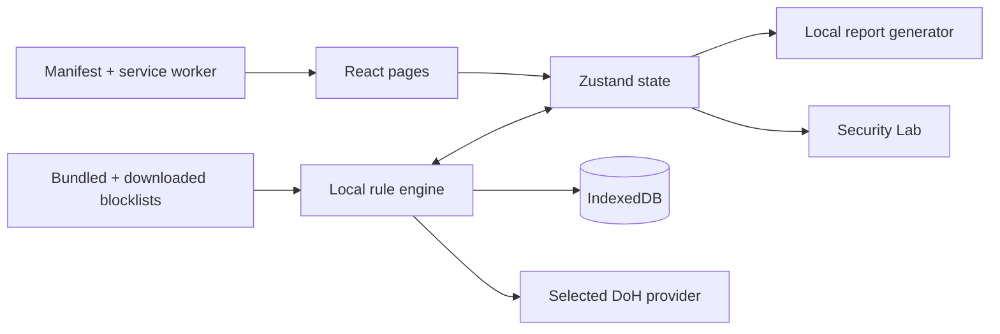

# PrivacyGuard Project Handbook

This is the operating, launch, privacy, security, and open-source guide for
PrivacyGuard. It is intended for maintainers, contributors, reviewers, and people
deploying the website or mobile package for the first time.

## Contents

1. [What PrivacyGuard is](#1-what-privacyguard-is)
2. [Capability boundary](#2-capability-boundary)
3. [How the application works](#3-how-the-application-works)
4. [How local data is stored](#4-how-local-data-is-stored)
5. [Run it locally](#5-run-it-locally)
6. [Launch the website](#6-launch-the-website)
7. [Publish with GitHub and GitHub Pages](#7-publish-with-github-and-github-pages)
8. [Install on Android and iOS](#8-install-on-android-and-ios)
9. [Build signed Android and iOS packages](#9-build-signed-android-and-ios-packages)
10. [Make the project open source](#10-make-the-project-open-source)
11. [Data-security launch checklist](#11-data-security-launch-checklist)
12. [Communicating local-first privacy](#12-communicating-local-first-privacy)
13. [Release process](#13-release-process)
14. [Operations and troubleshooting](#14-operations-and-troubleshooting)

---

## 1. What PrivacyGuard is

PrivacyGuard is a local-first privacy and network-security console. It provides:

- network and DNS activity views;
- application access policies and firewall-rule evaluation;
- DNS ad, tracker, analytics, telemetry, and malware filtering;
- AI endpoint classification and warnings about likely data categories;
- blocked-connection history with one-tap rule reversal;
- phishing-link analysis that runs locally;
- camera, microphone, location, notification, and clipboard permission status;
- automation, local reports, and sensitive-log exports;
- Android and iOS installability as a Progressive Web App (PWA);
- Capacitor configuration for signed Android APK/AAB and iOS builds.

The product principle is simple:

> The user's privacy data belongs on the user's device.

PrivacyGuard has no mandatory account, advertising SDK, application telemetry,
analytics beacon, or project-operated cloud backend.

## 2. Capability boundary

The current repository is a React/Vite web application and installable PWA. A browser
is intentionally isolated from the operating system. That security boundary affects
what this edition can observe and enforce.

| Capability | Current web/PWA edition | Native system integration required |
|---|---|---|
| Observe this app's own web requests | Yes, real | No |
| Run real DoH lookups and block before lookup | Yes | No |
| Evaluate blocklists, app policies, rules, and automation | Yes | No |
| Persist local events, settings, rules, and reports | Yes | No |
| Probe local AI HTTP endpoints | Yes, subject to browser CORS/PNA | No |
| Inspect HTTPS payloads | No, intentionally | Not planned; metadata-only policy |
| Capture every other app's network traffic | No | Android VPN service, Apple Network Extension, or desktop WFP/ETW |
| Attribute every flow to another process | No | Native OS APIs |
| Block another app at the OS firewall | No | Native OS APIs / managed DNS / VPN |
| Detect camera use by every other app | No | Native OS permission and app-ops integration |

Every connection is labeled:

- `OBS`: directly observed by this application;
- `SIM`: produced by the clearly labeled demonstration traffic plane.

The demo plane exists so the policy UI can be evaluated without pretending the
browser can read the system network stack. Disable it under **Settings → Monitoring →
Demo traffic plane** to view observed events only.

## 3. How the application works

### 3.1 High-level architecture



There is no application API server between the UI and the database. Components call
the local store and engine directly. IndexedDB is opened by the browser on the same
origin as the deployed application.

### 3.2 Important source files

| Path | Responsibility |
|---|---|
| `src/App.tsx` | App boot sequence and page routing |
| `src/lib/store.ts` | Local application state, policies, lists, rules, settings |
| `src/lib/engine.ts` | Verdict pipeline, event ingestion, real DoH, probes, reports |
| `src/lib/db.ts` | IndexedDB schema, buffered writes, retention, deletion |
| `src/lib/threats.ts` | Data-destination classification and local phishing heuristics |
| `src/lib/catalog.ts` | Application catalog and bundled blocklist snapshots |
| `src/lib/pwa.ts` | PWA install prompt and service-worker registration |
| `src/pages/Security.tsx` | Executable local security test suite |
| `public/sw.js` | Same-origin offline shell cache |
| `public/manifest.webmanifest` | Android/iOS-compatible app metadata |
| `capacitor.config.json` | Native Android/iOS wrapper configuration |

### 3.3 Startup sequence

1. `src/main.tsx` registers PWA behavior and mounts React.
2. `App.tsx` starts the engine and shows a short local boot screen.
3. `engine.ts` opens IndexedDB and restores counters and notifications.
4. The engine starts page-resource observation and connectivity checks.
5. The service worker caches the same-origin application shell.
6. If enabled, the labeled demo plane begins producing policy-test traffic.
7. Buffered event records are flushed to IndexedDB every few seconds.
8. Retention and automatic-report jobs execute locally on schedule.

### 3.4 Connection-decision pipeline

For each flow, `evaluate()` applies controls in this order:

1. Master monitoring/firewall state.
2. Custom denylist and enabled category blocklists.
3. Destination-specific firewall rules.
4. Application-level firewall rules.
5. Per-application policy: allow, block, localhost-only, or temporary allow.
6. AI privacy controls and local-AI-only policy.
7. Strict mode default-deny.
8. Local automation rules.

The resulting event contains the verdict and every reason that contributed to it.
Blocked events have zero transmitted and received bytes because the engine models a
pre-connect refusal.

### 3.5 DNS and ad blocking

DNS lookups initiated in **DNS Monitor** use Google or Cloudflare DNS-over-HTTPS. Before
the request is sent, the domain is checked against:

1. the custom denylist;
2. the custom allowlist, which overrides category lists;
3. malware;
4. ads;
5. trackers;
6. analytics;
7. telemetry;
8. the custom blocklist.

If blocked, no DoH request is issued. This is tested by Security Lab. Clean responses
are cached locally for a short period.

DNS filtering cannot remove an advertisement delivered from the same hostname as the
content. For example, DNS alone cannot distinguish a video segment from an ad segment
when both use the same CDN hostname.

For phone-wide blocking, **Privacy Guides** explains how to use Android Private DNS or
an iOS encrypted-DNS profile. That protects other apps without sending any data to a
PrivacyGuard server because there is no PrivacyGuard server.

### 3.6 Data Monitor

Data Monitor does not decrypt or read request payloads. It classifies the documented
purpose of a destination and reports the categories that endpoint is designed to
receive. Each conclusion has a basis:

- `declared`: based on a vendor-documented endpoint;
- `inferred`: based on the app type or blocklist category;
- `unknown`: PrivacyGuard does not have enough evidence and refuses to guess.

This distinction is essential. A connection to an AI inference endpoint may carry a
prompt, code, a file, or an image, but encrypted TLS prevents this application from
knowing which specific content was sent. The UI must never present inferred content as
captured content.

### 3.7 Phishing scanner

The phishing scanner runs locally. It analyzes the URL structure for:

- punycode and homograph risk;
- raw IP hosts;
- credentials placed before `@`;
- brand typosquatting;
- high-abuse top-level domains;
- deep subdomain chains;
- urgency and credential-harvesting words;
- link shorteners;
- long or hyphen-heavy hostnames;
- executable, archive, and APK download paths;
- matches in currently loaded blocklists.

The optional **Verify live** action performs a real DoH lookup. Pasted URLs are not
sent to a project-operated service.

### 3.8 Camera and permission status

The PWA uses the browser Permissions API to query its own camera, microphone, location,
notification, and clipboard permission states. The camera test uses a real
`getUserMedia()` request, displays detection, and then stops every track. Frames are
not stored or uploaded.

The PWA cannot observe camera access by unrelated apps. A native implementation must
use platform APIs, and platform restrictions differ substantially between Android and
iOS.

### 3.9 Security Lab

Security Lab mutates real state, runs real decisions, restores test state, and attaches
evidence to each result. It tests enforcement, DNS, phishing heuristics, AI destination
classification, input rejection, local storage, metadata-only event shape, and
unexpected outbound hosts.

A network test that cannot run is marked `SKIP`, never `PASS`.

## 4. How local data is stored

### 4.1 Storage locations

| Data | Browser storage | Purpose |
|---|---|---|
| Connection metadata | IndexedDB `events` | History and reports |
| DNS metadata | IndexedDB `dns` | Query history and reports |
| Notifications | IndexedDB `notifs` | Local notification history |
| Saved reports | IndexedDB `reports` | User-generated summaries |
| Counters and job timestamps | IndexedDB `kv` | Local lifecycle state |
| Rules, policies, settings | `localStorage` | Fast startup and persistence |
| Offline app shell | Cache Storage | Offline startup only |

The data is scoped to the site's origin. Deploying the same code at a different domain
creates a different local data silo.

### 4.2 What is stored

- application label and internal ID;
- destination domain or IP;
- port and protocol;
- timestamp, metadata byte counts, and decision;
- DNS record type, answer, provider, latency, and block reason;
- user-created rules and settings.

### 4.3 What is never stored

- decrypted HTTPS content;
- prompts or AI conversations;
- source files or image contents;
- passwords, cookies, authorization headers, or tokens;
- camera frames, microphone audio, or clipboard contents;
- a remotely correlatable user ID.

### 4.4 Retention and deletion

Users select a retention period under **Settings → Data & logs**. The local cleanup job
removes old connection and DNS rows. Users can export logs, clear logs, or delete all
local data.

Browser storage can also be erased through browser site settings. Clearing site data or
uninstalling the PWA may remove the local database, depending on the platform.

### 4.5 Export warning

Exported files are no longer protected by origin-scoped browser storage. They may reveal
application names, domains, IPs, and timestamps. PrivacyGuard warns before export. Do
not attach a real user export to a public GitHub issue.

## 5. Run it locally

### 5.1 Requirements

- Node.js 20.19 or later;
- npm 10 or later;
- a current Chromium, Firefox, or Safari browser.

### 5.2 First run

```bash
git clone https://github.com/YOUR-USER/privacyguard.git
cd privacyguard
npm ci
npm run dev
```

Open the localhost URL printed by Vite.

Do not expose the Vite development server to the public internet. It is a development
tool, not the production host.

### 5.3 Production build

```bash
npm run build
npm run preview
```

The production output is written to `dist/`:

```text
dist/
  index.html
  manifest.webmanifest
  sw.js
  icons/
```

The JavaScript and CSS are embedded into `index.html`; PWA support files remain beside
it.

### 5.4 Test before launch

1. Run `npm audit --omit=dev --audit-level=high`.
2. Run `npm run build`.
3. Open **Security Lab → Run all tests**.
4. Investigate every failure; do not relabel it as expected without evidence.
5. In browser developer tools, verify the manifest has no errors.
6. Verify the service worker is activated.
7. Switch the network offline and reload the installed app.
8. Test Android and iOS layouts at narrow widths.
9. Verify **Settings → Delete all local data**.
10. Verify exported reports contain only the documented metadata.

## 6. Launch the website

PrivacyGuard is a static application. It does not need a server-side runtime or
database. Any HTTPS static host can serve `dist/`.

### 6.1 Hosting requirements

- HTTPS is mandatory for service workers and production PWA installation.
- Serve `manifest.webmanifest` with an appropriate manifest or JSON content type.
- Serve `sw.js` from the same directory scope as `index.html`.
- Do not add third-party analytics scripts.
- Do not proxy logs to a server.
- Do not inject advertising or session-replay scripts.

### 6.2 Generic static host

```bash
npm ci
npm run build
# Upload the contents of dist/ to the HTTPS document root.
```

The host must publish the files themselves, not the `dist` directory as an extra path
unless that path is intended.

### 6.3 Content Security Policy

For a production domain, configure a Content Security Policy at the host/CDN. Start
with report-only mode, run all features, then enforce it. The application currently
needs network access to:

- `dns.google` and `cloudflare-dns.com` for user-triggered DoH;
- `raw.githubusercontent.com` for a user-triggered blocklist update;
- `www.gstatic.com` for the optional connectivity check;
- `fonts.googleapis.com` and `fonts.gstatic.com` for fonts.

For a fully self-contained deployment, self-host the two font files and remove the
Google Fonts links. Then narrow `font-src` and `style-src` accordingly.

Never add `unsafe-eval`. Review any need for `unsafe-inline` before deployment.

## 7. Publish with GitHub and GitHub Pages

This repository includes `.github/workflows/pages.yml`. A push to `main` builds and
deploys `dist/` to GitHub Pages.

### 7.1 Create the repository

1. Create a GitHub account or organization.
2. In GitHub, choose **New repository**.
3. Name it `privacyguard`.
4. Choose **Public**.
5. Do not initialize it with another README, license, or `.gitignore`; they are already
   in this project.

From the project directory:

```bash
git init
git branch -M main
git add .
git commit -m "Initial open-source release"
git remote add origin https://github.com/YOUR-USER/privacyguard.git
git push -u origin main
```

Or with GitHub CLI:

```bash
gh auth login
gh repo create privacyguard --public --source=. --remote=origin --push
```

### 7.2 Enable GitHub Pages

1. Open the repository on GitHub.
2. Go to **Settings → Pages**.
3. Under **Build and deployment**, choose **GitHub Actions** as the source.
4. Open **Actions** and watch the `Build and deploy GitHub Pages` workflow.
5. When complete, the site is normally available at:
   `https://YOUR-USER.github.io/privacyguard/`.

The manifest and service-worker paths are relative, so the app works under the
repository subpath.

### 7.3 Optional custom domain

1. Add a domain under **Settings → Pages → Custom domain**.
2. Add the DNS records GitHub displays.
3. Wait for verification.
4. Enable **Enforce HTTPS**.
5. Re-test the PWA installation because browser storage is origin-specific; changing
   the domain creates a new empty local data store.

### 7.4 Recommended GitHub security settings

Under **Settings → Security / Code security and analysis**:

- enable Dependabot alerts;
- enable Dependabot security updates;
- enable secret scanning and push protection where available;
- enable private vulnerability reporting;
- keep GitHub Actions permissions read-only by default;
- allow write permissions only in the Pages deployment job;
- protect `main` and require pull-request review;
- require the CI workflow to pass before merge;
- require conversation resolution;
- prevent force pushes and branch deletion;
- use two-factor authentication for maintainers.

Do not put a production log export, signing key, Android keystore, Apple certificate,
API token, or `.env` file in Git.

## 8. Install on Android and iOS

### 8.1 Android PWA

1. Open the HTTPS deployment in Chrome on Android.
2. Tap **Install app** in PrivacyGuard, or Chrome menu → **Install app**.
3. Confirm installation.
4. Launch PrivacyGuard from the home screen.

If the prompt is absent, verify HTTPS, manifest validity, 192/512 icons, and service
worker activation.

### 8.2 iPhone and iPad web app

1. Open the HTTPS deployment in Safari.
2. Tap **Share**.
3. Select **Add to Home Screen**.
4. Enable **Open as Web App** if offered.
5. Tap **Add**.

Apple documents this flow in its Safari support guide. Chrome on iOS does not provide
the same PWA installation flow.

## 9. Build signed Android and iOS packages

Capacitor v7 dependencies and `capacitor.config.json` are included.

### 9.1 Android APK / AAB

Requirements:

- Node.js 20+;
- Android Studio 2024.2.1 or later;
- Android SDK;
- JDK 21 (included with current Android Studio);
- Android 6/API 23 minimum for Capacitor v7.

First native build:

```bash
npm ci
npm run build
npx cap add android
npx cap sync android
npx cap open android
```

Subsequent builds:

```bash
npm run cap:android
```

In Android Studio:

1. Use an emulator and a physical phone to test a debug build.
2. Run Android lint and inspect every requested permission.
3. Choose **Build → Generate Signed Bundle / APK**.
4. Choose **Android App Bundle** for Google Play or **APK** for controlled sideloading.
5. Create a strong release keystore and back it up offline.
6. Never commit the keystore, passwords, `key.properties`, or signing environment
   variables.

The generated package wraps the same application. System-wide VPN/firewall behavior is
not added merely by wrapping a website; it requires a reviewed native plugin and clear
VPN disclosure.

### 9.2 iOS package

Requirements:

- macOS;
- Xcode 16 or later;
- Apple Developer account for device distribution;
- iOS 14 minimum for Capacitor v7.

```bash
npm ci
npm run build
npx cap add ios
npx cap sync ios
npx cap open ios
```

Subsequent builds:

```bash
npm run cap:ios
```

In Xcode:

1. Select the app target and configure Team, bundle ID, and signing.
2. Review Info.plist usage descriptions. Do not request camera, microphone, location,
   contacts, or VPN permissions unless the shipped feature truly needs them.
3. Test on a physical iPhone/iPad.
4. Run **Product → Archive**.
5. Distribute with TestFlight or App Store Connect.

Non-jailbroken iOS devices do not generally install arbitrary unsigned `.ipa` files.
Use TestFlight, the App Store, or an authorized enterprise distribution method.

### 9.3 Store privacy declarations

Answer store privacy forms based on the exact binary you ship, not this document alone.
For the unmodified repository:

- there is no project-operated account or analytics backend;
- network/security metadata is stored on device;
- user-triggered DoH and blocklist requests contact the documented providers;
- camera test data is not stored;
- user exports leave browser storage only when the user chooses to download them.

If you add crash reporting, analytics, login, subscriptions, remote sync, or native VPN
services, update the disclosure and privacy policy before release.

## 10. Make the project open source

The repository includes:

- `LICENSE`: Apache License 2.0;
- `CONTRIBUTING.md`: contribution and testing expectations;
- `CODE_OF_CONDUCT.md`: community conduct rules;
- `SECURITY.md`: private vulnerability reporting process;
- `PRIVACY.md`: local-data privacy policy;
- issue and pull-request templates;
- CI, dependency review, and automated Pages deployment;
- Dependabot configuration.

### 10.1 Before making the repository public

1. Replace placeholder GitHub usernames and security contact details.
2. Run a secret scan over the full Git history, not just current files.
3. Confirm every bundled blocklist's license and attribution.
4. Confirm icons, name, and branding are yours to release.
5. Review third-party dependency licenses.
6. Run the Security Lab and production build.
7. Enable private vulnerability reporting.
8. Publish a signed `v1.0.0` release after the deployment is verified.

### 10.2 Contribution model

- Issues are public and must never contain personal logs or secrets.
- Security findings use private GitHub Security Advisories.
- Pull requests must explain data-flow changes.
- New outbound domains require documentation and a Security Lab telemetry-audit update.
- New storage fields require a privacy-policy update and deletion-path test.
- New permissions require a user-visible explanation and least-privilege review.

## 11. Data-security launch checklist

Use this checklist for every release.

### Code and supply chain

- [ ] `npm ci` succeeds from a clean clone.
- [ ] `npm audit --omit=dev --audit-level=high` passes.
- [ ] Full `npm audit` is reviewed.
- [ ] `npm run build` passes.
- [ ] GitHub dependency review passes on the pull request.
- [ ] No secrets, keystores, certificates, or production exports exist in Git history.
- [ ] The service worker caches same-origin application files only.
- [ ] Third-party dependency and blocklist licenses are reviewed.

### Product behavior

- [ ] Security Lab has no unexplained failures.
- [ ] Network tests that cannot run show `SKIP`, not `PASS`.
- [ ] Observed and simulated traffic remain visibly distinguished.
- [ ] Data classifications still show `declared`, `inferred`, or `unknown`.
- [ ] No screen claims to decrypt HTTPS.
- [ ] Camera test stops all tracks and stores no frames.
- [ ] Clear logs and delete-all-data controls work.
- [ ] Export warnings appear before sensitive files are generated.

### Hosting

- [ ] HTTPS is enforced.
- [ ] Manifest and icons load without errors.
- [ ] Service worker scope is correct.
- [ ] No analytics or session-replay scripts were injected by the host.
- [ ] CSP is enabled and tested.
- [ ] Custom domain is verified.
- [ ] Privacy and security policy links are visible in the repository.

### Mobile packaging

- [ ] Release is signed with a protected key.
- [ ] Requested permissions match shipped features.
- [ ] Store privacy labels match actual data flow.
- [ ] Android Data Safety and Apple Privacy Nutrition Label are reviewed.
- [ ] Physical-device tests pass.
- [ ] Uninstall/reinstall and local-data deletion are tested.

## 12. Communicating local-first privacy

Privacy messaging must be specific and verifiable. Recommended wording:

> PrivacyGuard stores connection metadata, DNS history, rules, settings, and reports in
> local browser or app storage on your device. PrivacyGuard does not operate an account,
> analytics, advertising, or log-ingestion backend. User-triggered DNS lookups and
> blocklist updates contact the selected third-party provider directly. Exported files
> leave protected app storage only when the user chooses to download or share them.

Avoid absolute marketing statements such as "sees everything", "blocks every ad", or
"guarantees safety". Accurate alternatives:

- "metadata-only inspection";
- "DNS-level blocking cannot remove same-origin ads";
- "the PWA observes its own context; system-wide capture requires native integration";
- "phishing heuristics reduce risk but cannot prove a site is safe";
- "unknown destinations remain unknown rather than guessed".

### Why local storage matters

Network logs can expose a person's employer, health interests, financial services,
political activity, AI tools, working hours, and device habits even without payloads.
Centralizing those logs creates a high-value breach target. Local-first storage reduces:

- mass data collection;
- cross-user correlation;
- server-side breach impact;
- mandatory account tracking;
- retention beyond the user's control.

Local storage is not magic protection. Anyone with access to an unlocked device or an
exported log file may read the data. Device encryption, a screen lock, short retention,
and careful export handling remain important.

Hosting is also not invisible. GitHub Pages or another static host receives the normal
web request needed to download PrivacyGuard (IP address, timestamp, path, and user
agent). The important boundary is that the application's connection database, rules,
reports, and test results are not uploaded to that host by the unmodified code.

## 13. Release process

1. Update version and release notes.
2. Run clean install, audit, build, and Security Lab.
3. Merge through a reviewed pull request.
4. Verify GitHub Pages deployment.
5. Create an annotated Git tag:

```bash
git tag -a v1.0.0 -m "PrivacyGuard v1.0.0"
git push origin v1.0.0
```

6. Create a GitHub Release from the tag.
7. Attach only reviewed artifacts. Do not attach unsigned APKs.
8. Publish checksums for downloadable binaries.
9. Keep release signing keys outside GitHub and outside the repository.

## 14. Operations and troubleshooting

### Install prompt does not appear

- Confirm the site uses HTTPS.
- Check DevTools → Application → Manifest.
- Check DevTools → Application → Service Workers.
- Confirm both 192×192 and 512×512 icons load.
- Confirm the app is not already installed.
- Use the browser menu as a fallback.

### GitHub Pages displays a 404

- Confirm **Settings → Pages → Source** is GitHub Actions.
- Confirm the Pages workflow succeeded.
- Use the URL shown by the deploy job.
- Do not open `index.html` directly with a `file://` URL; service workers require HTTP(S).

### DNS test fails

- Confirm the device is online.
- Try the alternate provider in DNS Monitor.
- Some managed networks block public DoH endpoints.
- Treat a skipped offline network test as skipped, not passed.

### Android build cannot find Java

- Use Android Studio 2024.2.1+.
- Select Android Studio's bundled JDK 21 as the Gradle JDK.
- Install the required Android SDK through SDK Manager.

### iOS build cannot be created

- iOS native builds require macOS and Xcode.
- Configure an Apple Development Team and unique bundle identifier.
- Use the PWA install path if App Store/TestFlight distribution is not available.

### A user reports a privacy or security issue

- Do not ask them to post logs publicly.
- Direct vulnerabilities to GitHub private vulnerability reporting.
- Ask for the minimum reproduction details.
- Redact domains, usernames, paths, and IPs unless strictly necessary.
- Follow `SECURITY.md` for coordinated disclosure.

---

## Reference links

- GitHub Pages: <https://docs.github.com/pages>
- GitHub private vulnerability reporting: <https://docs.github.com/code-security/security-advisories/guidance-on-reporting-and-writing/privately-reporting-a-security-vulnerability>
- Capacitor environment setup: <https://capacitorjs.com/docs/getting-started/environment-setup>
- Capacitor v7 support: <https://capacitorjs.com/docs/main/reference/support-policy>
- Apple web app installation: <https://support.apple.com/guide/iphone/turn-a-website-into-an-app-iph42ab2f3a7/ios>
